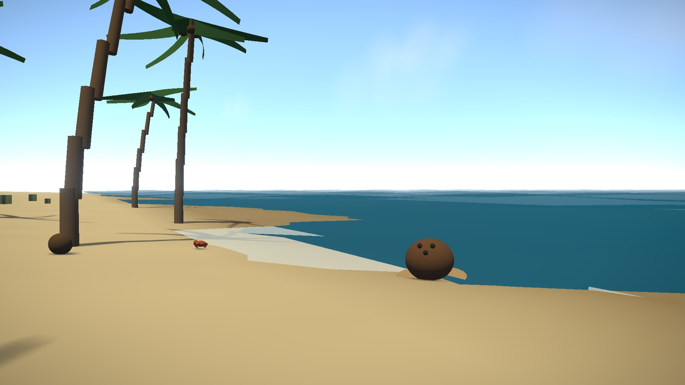
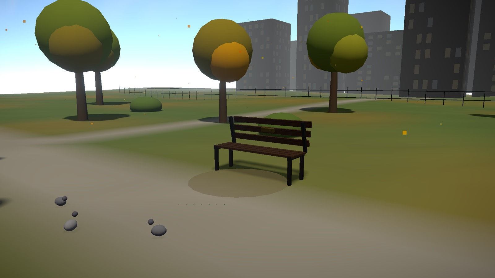
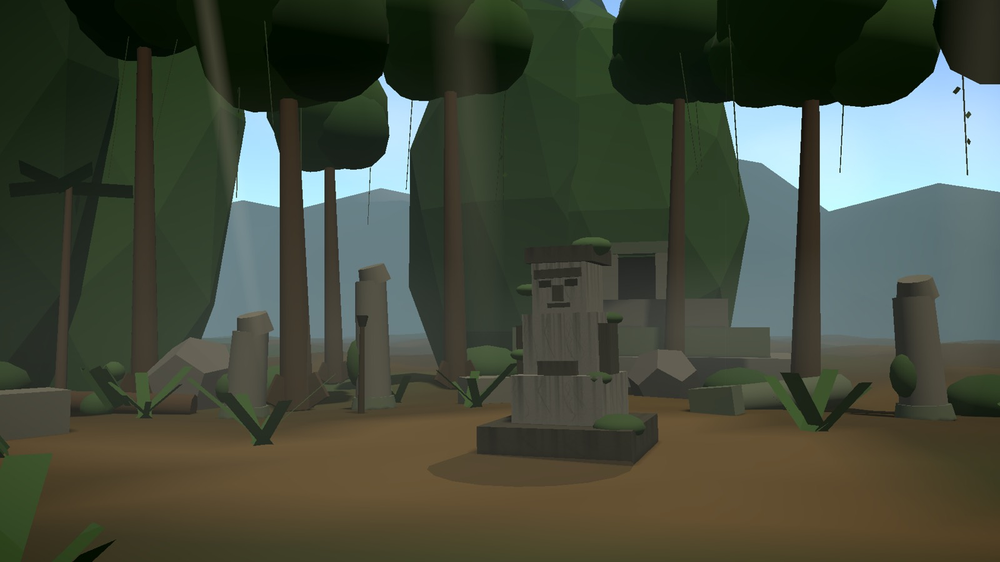

# Simulator Collection

**Play it: [simulatorgame.vercel.app](https://simulatorgame.vercel.app)**

A browser game where you are a coconut, a park bench or a jungle idol. You cannot move. You cannot act. The world goes on around you anyway: crabs, joggers, explorers, weather, sunsets, and the occasional pirate ship or UFO.

The joke is the gap between the premise and the presentation. The interface is played completely straight, like a prestige single-player release: serif title cards, slow fades, a system notice explaining that Arcade mode does not change the fact that you are an inanimate object.

| Coconut Simulator | Bench Simulator | Jungle Idol Simulator |
|---|---|---|
|  |  |  |

## Features

- **Three living scenes**, all procedural low-poly (no downloaded models or textures): a tropical beach, an autumn city park and a jungle temple.
- **47 scripted background events**, from common (crabs, cyclists, butterflies) to rare (a pirate ship, a flash mob, a banana that runs past). Each camera is placed so the events play out in view.
- **Day/night cycle and weather** (clear, cloudy, rain, storm, and fog in the jungle), with per-scene atmosphere.
- **Ambient audio** generated in the browser.
- **Achievements and a Record of Existence**: time existed, events witnessed, movement (always 0 metres). Progress is saved in the browser.
- **Fully keyboard playable**: Tab and Enter to choose, Escape to go back or pause.

## Run it locally

Needs Node.js 22.18 or newer (the tests run TypeScript directly with Node's built-in test runner).

```bash
npm ci
npm run dev        # start the dev server
npm test           # achievement rule tests (node:test)
npm run typecheck  # TypeScript check
npm run build      # production build into dist/

npx playwright install chromium   # once, for the browser tests
npm run test:e2e   # end-to-end tests: every screen and simulator, in a real browser
```

GitHub Actions runs all of these on every push (`.github/workflows/ci.yml`).

## How it works

Built with React, [React Three Fiber](https://r3f.docs.pmnd.rs/) (Three.js), Zustand and Motion. Everything runs client-side; there is no backend.

```
src/
  app/App.tsx                 menus, HUD, pause, loading screen
  simulator/
    registry.ts               the three simulators (each scene is its own lazy chunk)
    engine/                   canvas, lighting, camera, audio, post-processing
    systems/                  time of day, weather, the event scheduler
    scenes/<scene>/           terrain, props, the object you play, and events/
    state/                    simulator store, achievements, saved progress
```

The 3D engine is loaded only when you pick a simulator, so the menus appear quickly.

### Adding a background event

Events are declarative. Each scene has an events file (for example `scenes/coconut/events/coconutEvents.ts`) that lists events with a name, duration, probability and cooldown:

```ts
channelEvent(channels.crab, { name: "crab-walks-past", duration: 14, probability: 0.22, cooldown: 30 }),
```

The scheduler rolls each event's probability every 5 seconds. An actor component in the same folder reads the event's channel every frame to show and animate itself. To add an event: add a channel name, add a `channelEvent(...)` line, and write an actor that uses `useEventAnim(channel, ...)`.

### Adding an achievement

Achievements live in `src/simulator/state/achievements.ts`. Each one either unlocks on a named event (`event: "ufo-crosses-sky"`) or on a condition over your stats (`earned: (s) => s.eventsWitnessed >= 25`). The tests check that every event-based achievement points at an event that really exists.

## Credits

See [ATTRIBUTIONS.md](ATTRIBUTIONS.md).
